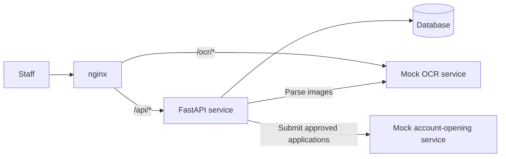

# Software engineer intern take-home exercise

Build an identity verification service for securities account applications with a FastAPI backend, external service integrations, and a container deployment.

| Item | Requirement |
|---|---|
| Suggested effort | 8-12 hours |
| Submission deadline | Within one week |

## 1. Scenario

A fictional securities platform receives account applications with scanned identity cards. Staff upload applications in batches. Each application is a case with an identity-card image reference and applicant metadata.

An external optical character recognition (OCR) service extracts identity fields. An operations officer reviews each case at stage 1. A supervisor reviews approved cases at stage 2. The service exports approved cases and submits the files to a mock account-opening service.

The exercise covers identity-field extraction, review decisions, and handoff to account opening. All applicant data is fictional. Identity numbers use the synthetic prefix `TEST-ID-`.



The mock services inject failures to exercise failure handling. Read their [OCR contract](mock_ocr/README.md) and [account-opening contract](mock_onboarding/README.md), then send test requests before designing the integrations. Requirements come from these contracts and the module requirements below.

## 2. Fixed structure and naming

The repository contains service mocks, sample data, application scaffolding, deployment stubs, and submission templates.

```text
.
├── README.md
├── REFLECTION.md
├── TOOLS.md
├── AI_LOG.md
├── requirements.txt
├── data/
│   └── account_applications.csv
├── mock_ocr/
│   ├── README.md
│   ├── server.py
│   └── Dockerfile
├── mock_onboarding/
│   ├── README.md
│   ├── server.py
│   └── Dockerfile
├── q1_api/
│   ├── README.md
│   ├── app/
│   │   └── main.py
│   └── tests/
├── q2_integration/
│   └── README.md
└── q3_deploy/
    ├── README.md
    ├── Dockerfile
    ├── docker-compose.yml
    ├── nginx.conf
    ├── .env.example
    ├── RUNBOOK.md
    └── scripts/
        ├── backup.sh
        └── smoke_test.sh
```

Keep the application entry point importable as `app.main:app` from `q1_api/`. Place application modules in `q1_api/app/` and tests in `q1_api/tests/`. Module 2 extends the same application in place. Keep its implementation within this layout, without adding a top-level directory or a second application service.

Keep the deployment filenames shown above. Compose service names must be `api`, `mock_ocr`, `mock_onboarding`, and `nginx`. Use `mongo` for the database service if you choose MongoDB.

### Development requirements

Use Python 3.10 or later and FastAPI. MongoDB is recommended. SQLite is also accepted. Record the database choice and its rationale in [REFLECTION.md](REFLECTION.md).

To start MongoDB locally:

```bash
docker run -d --name mongo -p 27017:27017 mongo:8
```

AI tools, search engines, and open-source code are permitted. Candidates must understand and be able to explain their submitted code. Identify AI-generated code requiring further review in `REFLECTION.md`.

Keep real credentials and local `.env` files out of Git. Provide `q3_deploy/.env.example`. Preserve `.gitignore` if it is present.

Use these code-size estimates to control scope:

| Module | Expected size |
|---|---|
| Q1 | Approximately 500 lines of application code, excluding tests |
| Q2 | Approximately 400 additional lines of application code |
| Q3 | Approximately 200 lines of configuration and scripts |

These estimates are guidance, rather than limits. Keep the implementation focused on the stated requirements and remove unused code and unnecessary dependencies.

Create one commit per module with a descriptive message. Preserve the development history and do not force-push. Record incomplete work and known failures in `REFLECTION.md`.

## 3. Module 1: Core API

Implement the API and review state machine. Module 1 must run locally without Docker. See [q1_api/README.md](q1_api/README.md) for the application entry point and test command.

### Q1.1 Batches, cases, and validation

| Endpoint | Required behavior |
|---|---|
| `POST /api/batches` | Import `data/account_applications.csv` and create a batch. Use a multipart upload or a file path, and document the choice. |
| `GET /api/batches/{id}` | Return batch details and case counts for each status. |
| `GET /api/batches/{id}/cases?status=&page=&page_size=` | List cases with status filtering and pagination. |

The sample CSV contains 50 synthetic applications, including invalid dates, missing names, and duplicate `case_ref` values. Its columns are `case_ref`, `applicant_name`, `id_number`, `dob`, `issue_date`, and `image_ref`. Both date fields use `YYYY-MM-DD`.

Validate rows at import. The batch response must include accepted and rejected row counts, with a reason for each rejected row.

Validation errors must identify the row and the problem so staff can correct the input. Do not return `500 Internal Server Error` or a stack trace for invalid input.

### Q1.2 Review state machine

The approval path is:

```text
pending -> ocr_done -> stage1_approved -> stage2_approved -> exported
```

OCR failures enter `ocr_failed`. Rejection at stage 1 enters `stage1_rejected`. A rejection at either review stage is terminal. Rejected cases must be excluded from subsequent review stages and exports.

Implement `POST /api/cases/{id}/review` with `stage` set to `1` or `2`, and `decision` set to `approve` or `reject`. For example:

```json
{"stage": 1, "decision": "approve"}
```

Invalid transitions must return HTTP `409` with a reason. Examples include stage 2 review before stage 1 approval, review of an `ocr_failed` case, and repeating a decision for the same review stage.

Define transition rules in one place.

### Q1.3 Tests

The pytest suite must cover:

- Import of invalid CSV rows, including counts and rejection reasons.
- The successful case lifecycle.
- At least three invalid transitions that return HTTP `409`.

Run the suite from the repository root. The command must pass from a clean checkout:

```bash
python -m pytest q1_api/
```

## 4. Module 2: OCR integration and export delivery

Extend the Module 1 application to use both mock services. The API and mocks must also run together without Docker. See [q2_integration/README.md](q2_integration/README.md) for standalone startup commands.

### Q2.1 Trigger OCR processing

Implement `POST /api/batches/{id}/process` to submit every `pending` case in the batch to OCR. Store successful parsed fields and set the case to `ocr_done`. Set failed cases to `ocr_failed` and record the failure reason.

The endpoint must return a batch status without waiting for all 50 cases to finish. `GET /api/batches/{id}` must show progress while processing continues. Record the background-processing approach and its rationale in `REFLECTION.md`.

Approximately 10% of the sample image references are unreadable. These cases must reach `ocr_failed` with the OCR service's reason recorded.

### Q2.2 OCR timeouts, retries, and recovery

Apply the failure behavior in the [OCR contract](mock_ocr/README.md#failure-behavior). The contract defines deterministic results, transient failures, delayed responses, and unreadable scans.

Configure explicit timeouts and bounded retries with backoff. Every OCR run must finish with `ocr_done` or `ocr_failed`. Record a reason when retries are exhausted.

Cases interrupted by a worker crash or a lost response must support processing again. Repeated processing must produce the same stored fields and final status as a single successful attempt. Cases must not remain indefinitely in an intermediate processing state.

Record the observed failure rates, measurement method, timeout rationale, retry limit, and staff-visible handling of exhausted retries in `REFLECTION.md`. The mock configuration defines failure types and probabilities. Candidates must measure actual outcomes.

Verify recovery by stopping a worker during processing, processing the batch again, and comparing the final state with a clean run. Use `GET /debug/requests` to inspect recorded attempts and include the comparison evidence in `REFLECTION.md`.

### Q2.3 Export and delivery

Implement `POST /api/batches/{id}/export` to create a CSV containing exactly the `stage2_approved` cases and transition those cases to `exported`. A later export with no new approvals must exclude previously exported cases.

Submit each export to the account-opening service using its [ingestion contract](mock_onboarding/README.md#ingestion-contract). Use one idempotency key for all delivery attempts of the same export. A different export must have a different key. Derive the key from the export identity, such as its filename or content, and record the rationale in `REFLECTION.md`.

A lost response after ingestion must not cause a duplicate ingestion when delivery is retried. Record the account-opening service's receipt against the export. Use `GET /debug/deliveries` to verify that each export was ingested exactly once.

## 5. Module 3: Deployment and operations

Complete the deployment stubs in `q3_deploy/`. See [q3_deploy/README.md](q3_deploy/README.md) for file responsibilities and nginx configuration checks.

### Q3.1 Container deployment

Provide an API `Dockerfile` and a Compose configuration that runs the API, database, mock OCR, mock account-opening service, and nginx. Use the fixed service names in section 2. For SQLite, provide persistent database storage for the API.

nginx must receive external traffic and proxy `/api/*` to the API and `/ocr/*` to the mock OCR service. Complete the supplied configuration for the application's routing, request sizes, and timeout behavior.

After local configuration is prepared, this command must start a seeded, working system from a clean checkout:

```bash
cd q3_deploy
docker compose up --build
```

### Q3.2 Health, configuration, and startup order

Provide `/api/health` for liveness and a readiness signal that checks database reachability. The API must report ready only when the database is reachable.

Encode startup dependencies in Compose using service health checks. Use `depends_on` with `condition: service_healthy` where a service waits for another to become healthy. Avoid fixed startup delays such as `sleep 5`.

Read environment-specific values from environment variables or a local `.env` file. Provide the required variables in `.env.example` and document the configuration step in the runbook.

### Q3.3 Backup and runbook

Implement `q3_deploy/scripts/backup.sh` to back up the database while the system is running. Write each backup to a timestamped file and retain only the seven most recent backups. Include a before-and-after file listing in `REFLECTION.md` to demonstrate retention.

Complete [q3_deploy/RUNBOOK.md](q3_deploy/RUNBOOK.md) with tested instructions for startup, log access, OCR failure diagnosis, and backup restoration. Keep the instructions concise enough for an on-call operator to follow. About half a page is sufficient if all four tasks are covered.

## 6. Optional task

Choose one task:

| Task | Requirements |
|---|---|
| External partner API | Add an API-key-authenticated router under `/external/*`, separate from the staff API. Expose only batch status and export download. Apply a basic rate limit. Explain the threat addressed in three to five sentences. |
| Continuous integration (CI) | Add a GitHub Actions workflow that runs the tests and `docker compose build` on every push. The workflow must pass for the final commit. |

## 7. Submission

1. Fork this repository and keep the fork public.
2. Verify startup from a clean clone. Prepare local configuration as specified in the runbook, then run `docker compose up --build` from `q3_deploy/`.
3. In another terminal, run `bash scripts/smoke_test.sh` from `q3_deploy/`. The script must drive one batch through upload, OCR, both review stages, export, and delivery.
4. Run `python -m pytest q1_api/` from the repository root. Verify the API with both mocks running locally without Docker.
5. Keep only dependencies used by the submission in `requirements.txt`.
6. Complete [REFLECTION.md](REFLECTION.md), [TOOLS.md](TOOLS.md), and [AI_LOG.md](AI_LOG.md).
7. Submit the repository URL and final commit hash by email. Follow the commit requirements in section 2.
